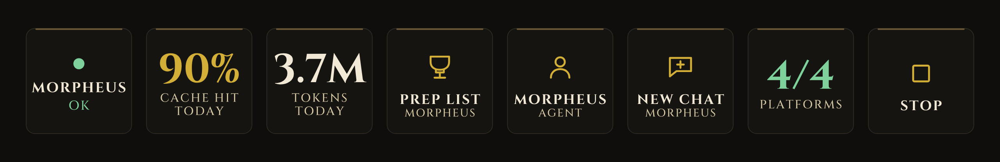

<p align="center"></p>

# Winged Keys (beta)

<p align="center"></p>

> **Beta.** Tested on one Stream Dock M18 on Windows with Hermes 0.22.1. Other models are covered by simulated tests only. Expect rough edges and please report issues.

Stream Deck–style keys for a self-hosted [Hermes Agent](https://hermes-agent.nousresearch.com/): see whether your agent is up, watch token and cache usage, fire preset prompts, and stop runs, from a physical key.

Builds for:
- **Mirabox Stream Dock** (tested on a Stream Dock M18, Windows, app 3.10.205)
- **Elgato Stream Deck** (experimental: simulated tests only; see "Elgato status")

Supported controls: keys on every model, the touch strip on Stream Dock N4/N4 Pro, knobs on Stream Dock N3/N4 and dials on Elgato Stream Deck+ (press = same as the key; turning a **Usage** dial changes what it shows).

> Community project. Not made by, affiliated with, or endorsed by Nous Research, Mirabox or Elgato.

## Keys

| Key | What it shows / does |
|---|---|
| **Status** | Green: Hermes is up and your API key works. Amber: no key, bad key, or a non-local address. Red: Hermes is off. |
| **Ask** | Sends the key's preset prompt to Hermes as a run, waits, and saves the reply as a Markdown file. Optional: add your clipboard text to the prompt (turn on **Ask with clipboard** under **Optional features** first). Shows *needs OK* when the agent is waiting for your approval (approve it with an **Approve** key, or in your Hermes app or WebUI). |
| **Approve** | When an Ask run is waiting for your OK, shows what the agent wants to run (for example `rm -rf build`). Press to approve it **once**. Can be set to **Deny** instead. A press right after a new request appears only shows it, so nothing is approved unseen. |
| **Stop** | Stops Ask runs in progress. |
| **Usage** | One number per key: cache hit %, tokens, sessions or model calls (all chats, all agents added up or one agent; today, 7 or 30 days), or API-server tokens, requests, p95 response time, agents running. Pressing it while the dashboard is off starts the dashboard. |
| **Platforms** | How many Hermes connections are up, e.g. `4/4`. Turns red and names the one that dropped. |
| **Open** | Opens the Hermes WebUI, the Hermes dashboard, the latest Ask reply, or a web address you set. |
| **Agent** | Switches which Hermes agent (profile) the keys talk to, for example Morpheus or The Chef. Ask, Stop, Status and New chat follow it. |
| **New chat** | Starts a fresh conversation for the current agent. Ask keys set to *continue the conversation* keep Hermes's memory between presses until you press it. |
| **Model** | Switches which model Hermes uses for Ask keys: Hermes's own default, or one of the models you list in the key's settings. Turning a dial steps both ways. Each reply file names the model that answered. |

## Requirements

- Hermes Agent with its **API server** turned on (Ask, Stop, Status). In your Hermes `.env`:
  ```
  API_SERVER_ENABLED=true
  API_SERVER_KEY=<a long random value you make yourself>
  ```
  Then restart the Hermes gateway. Default address: `http://127.0.0.1:8642`.
- The **Hermes dashboard** for Usage and Platforms keys (`hermes dashboard`, default `http://127.0.0.1:9119`). The plugin can start it for you.
- Developed against Hermes 0.22.1. Older versions may differ.
- Windows 10+ (macOS untested).

## Install

**Stream Dock:** copy `streamdock/com.wingedkeys.hermes.sdPlugin` into `%APPDATA%\HotSpot\StreamDock\plugins\` and restart the Stream Dock app.

**Elgato Stream Deck (testing only):** copy `elgato/com.wingedkeys.hermes.sdPlugin` into `%APPDATA%\Elgato\StreamDeck\Plugins\` and restart Stream Deck.

Then drag keys from the **Winged Keys** category and click one. In the settings panel:

1. **Find Hermes** looks up the Hermes address from the dashboard (needs the dashboard running). Check it and click **Use this address**.
2. If the API server isn't on yet, open **First-time setup**: click **Make a key**, copy the two lines into your Hermes `.env`, and restart the Hermes gateway.
3. If your `.env` already has a key, you can tick **Read key from Hermes** under **Optional features** and click **⚠ Read key from Hermes** instead of pasting it (see [SECURITY.md](SECURITY.md)).
4. **Test connection** tells you in plain words what is working and what isn't.

## Using several agents

Hermes serves every agent (profile) on the same port, and each named agent checks **its own** `API_SERVER_KEY`. Hermes does not reuse the main key for them. To use the **Agent** key with an agent other than *default*:

1. Add an `API_SERVER_KEY=...` line to that agent's `.env` (Windows: `%LOCALAPPDATA%\hermes\profiles\<agent>\.env`). It can be the same value as your main key or a different one.
2. Restart the Hermes gateway.
3. In the settings panel, tick **Read key from Hermes** under **Optional features**, then click **⚠ Read key from Hermes**. It picks up the main key and each agent's key, and tells you which agents still need one.

## Switching models

Hermes has no API call that changes its default model. Instead, each Ask run can name the model it wants, and Hermes uses it for that run ([API server docs](https://hermes-agent.nousresearch.com/docs/user-guide/features/api-server)). The **Model** key picks which model Ask keys name.

1. Drag a **Model** key onto your deck and click it.
2. List your models, one per line: `provider:model` (for example `openrouter:anthropic/claude-sonnet-4.6`) or just the model name. Use the names your Hermes `/model` command accepts. A model with a colon in its own name (like `llama3:8b`) needs its provider in front.
3. Press the key to step through *default* (Hermes's own setting) and your list.

Notes:
- Hermes's default model is not changed, and Telegram, Discord and the WebUI keep using it.
- A chat where you already switched models with `/model` keeps that model; Hermes gives a chat's own `/model` choice priority.
- The model applies to whichever agent the **Agent** key has chosen.
- Each Ask reply file names the provider and model that actually answered, so you can see if Hermes used something else.

## Security

The full list of what the plugin reads, when, and where data goes is in [SECURITY.md](SECURITY.md). In short:

- The Hermes API server gives the agent **full tool access, including terminal commands**. Keep it on `127.0.0.1`. Do not expose it to the internet.
- The plugin only talks to local addresses unless you tick "Allow a non-local address", and then only over https. It never follows redirects.
- Your API key is typed into the settings panel and stored by the Stream Dock / Stream Deck app. It may be stored unencrypted. It is never written to logs, shown on a key, or sent to the dashboard. It is sent only to the Hermes address in your settings; **Find Hermes** only proposes an address (taken from the dashboard and checked to answer like Hermes); it is saved only when you click **Use this address**.
- **Make a key** shows the new key in plain text. Don't use it while streaming or sharing your screen.
- Usage keys read the dashboard's session token from the dashboard page the same way your browser does, keep it in memory only, and never display it.
- **Read key from Hermes** and **Ask with clipboard** are **off by default**. Turn them on under **Optional features** in the settings panel.
- **Read key from Hermes** opens your Hermes `.env` (the standard location, or one you set) and copies only the `API_SERVER_KEY` line into the plugin's settings. It runs only when you click it and confirm a warning. Network paths are refused. Use it only on your own computer.
- Clipboard Ask sends whatever you have copied to the agent. Neither Stream Dock nor Stream Deck lets plugins read the clipboard, so on Windows the plugin reads it with PowerShell (`Get-Clipboard`). Don't use it with passwords on the clipboard.
- The plugin never approves agent actions for you. The **Approve** key answers only when you press it, only for the exact request it has been showing for at least 1.5 seconds (checked with Hermes again just before answering), only for runs started from your own Ask keys, and only with *once* or *deny*, never *always*. The command preview comes from Hermes, which removes secrets from it first; it is not written to the log.
- The plugin starts programs only with fixed arguments and never through a shell: hermes.exe with `dashboard --no-open --port <port>` (the hermes.exe path is the standard one or the full path you set), the OS clipboard reader, and the OS "open file" command for its own reply files.

## Known limits

- Usage keys depend on parts of Hermes that are not documented (the dashboard's session token and its analytics fields). A Hermes update may break them; the key then shows *auth* or *off* instead of wrong numbers.
- Tested on Windows only. macOS is untested.
- Only one Stream Dock model (M18) has been tested on real hardware.

## Files the plugin writes

- Ask replies: `%USERPROFILE%\WingedKeys\replies\ask-YYYYMMDD-HHMMSS.md` (changeable).
- Log: `%USERPROFILE%\WingedKeys\plugin.log`. Event names and setting *names* only, never values.

## Development

No dependencies. Node 20+.

```
node build.js        # writes plugin/index.js into both builds
node test/test.js    # 60+ checks against a fake Hermes and a fake Stream Dock
node test/models.js  # per-controller checks: keys, touch strip, Stream Dock knobs, Stream Deck+ dials
node test/agents.js  # Agent key, per-agent routing and keys, New chat
node test/approve.js # Approve key: preview, deliberate press only, exact request, once/deny only
node test/modelkey.js  # Model key: model list, dials, the model sent with each Ask run
PLUGIN=elgato/com.wingedkeys.hermes.sdPlugin node test/test.js
PLUGIN=elgato/com.wingedkeys.hermes.sdPlugin node test/models.js
```

`src/wsclient.js` is a small hand-written WebSocket client so the plugin needs no npm packages.

## Elgato status

The Elgato build uses the same code and Elgato's manifest format and image sizes. It passes the same simulated tests. It is **not** yet tested on real Stream Deck hardware. Publishing on the Elgato Marketplace requires packaging with Elgato's CLI, which enables DRM and requires their official `@elgato/streamdeck` library. That port is still to do.

## Credits

Built by [overture-sys](https://github.com/overture-sys) with Claude (Anthropic).

Key lettering uses [Cinzel](https://github.com/NDISCOVER/Cinzel) by Natanael Gama, licensed under the SIL Open Font License 1.1 (`Cinzel-OFL.txt` in each plugin folder).

## Support

If Winged Keys is useful to you, you can support its development on [Ko-fi](https://ko-fi.com/overturesys). ♥

## License

MIT. See [LICENSE](LICENSE).
